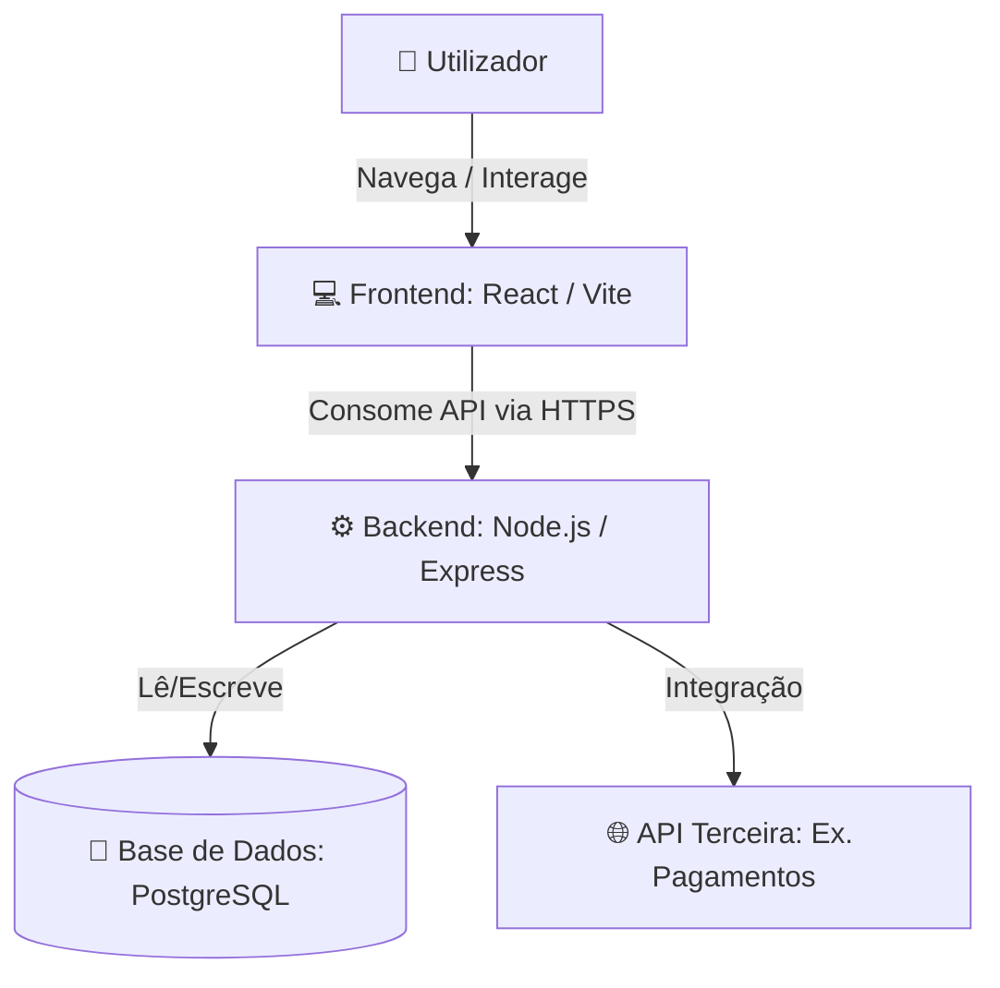

# Arquitetura do Sistema: SHALOM

## 1. Visão Geral e Objetivo
* **O Problema:** [Muitas pessoas procuram aprender sobre Deus, no entanto não têm condições de comprar uma biblia e os 
que têm encontram problemas para entender a mensagem dos versiculos biblicos].
* **Prioridades Técnicas:**  [Simplicidade de código, custo zero de infraestrutura, entrega rápida].

## 2. Requisitos e Restrições Básicas
* **Funcionalidades Chave:**
  * [Cadastro e autenticação de utilizadores]
  * [Apresentação de versiculos biblicos]
* **Restrições:**
  * *Prazo/Equipa:* [ Desenvolvido apenas por 1 pessoa em 4 semanas].
  * *Stack:* [ Node.js (Backend) e React (Frontend)].

## 3. Visão Geral do Sistema (Diagrama)
*Diagrama simples unificando Contexto e Componentes usando Mermaid.*

## 4. Decisões de Projeto (Histórico)
*Registo rápido do porquê de certas escolhas, sem burocracia:*
* **Base de dados Relacional:** Optei por SQLite porque oferece o poder do SQL num único arquivo local, sem a necessidade de instalar ou gerir um servidor..
* **Autenticação com JWT:** Implementação simples via tokens armazenados no cliente, sem necessidade de sessão em memória no servidor.

## 5. Estrutura de Dados (Tabelas Principais)
*Resumo rápido do modelo de dados.*
* **Users:** `id` (PK), `name`, `email`, `password_hash`, `created_at`

## 6. Infraestrutura e Deploy
* **Frontend:** Hospedado na [Vercel / Netlify] com build automático a partir do branch `main`.
* **Backend e BD:** [Render / Railway / Supabase] (Plano gratuito).
* **Variáveis de Ambiente:** Configuradas diretamente no painel da plataforma de hospedagem (ficheiro `.env` local listado no `.gitignore`).
*