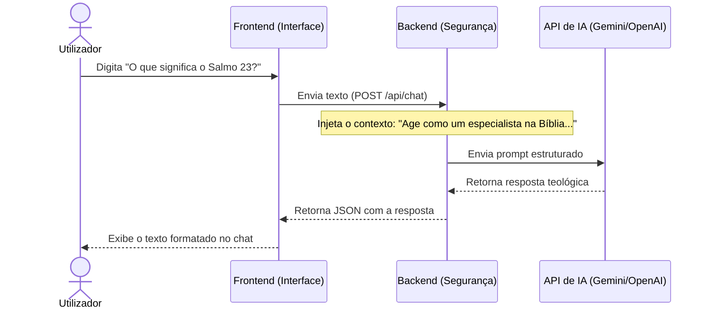

# Manual de Funcionamento: Espaço Devocional

## 1. Fluxos de Execução Principais

### 1.1. Fluxo do Chatbot Bíblico
Este fluxo explica como a mensagem do utilizador chega até a Inteligência Artificial e retorna uma resposta contextualizada sobre a Bíblia.

### 1.2. Fluxo de Customização Visual (Cores e Modo Escuro)
1. O utilizador clica no botão de alternar tema (Modo Escuro) ou seleciona uma cor de destaque.
2. O **Frontend** captura o evento e altera o atributo no elemento raiz (ex: `document.body.classList.toggle('dark-mode')`).
3. O **Frontend** atualiza o valor no `LocalStorage` do navegador (`localStorage.setItem('theme', 'dark')`).
4. Ao reabrir a aplicação, o sistema lê o `LocalStorage` primeiro para carregar o visual preferido do utilizador instantaneamente, evitando oscilações de luz na tela.

### 1.3. Fluxo do Player de Meditação
* As músicas de fundo (instrumentais, sons de chuva, etc.) são carregadas a partir de uma lista estruturada. 
* O utilizador pode dar Play/Pause enquanto navega pelos versículos ou conversa com o Chatbot (o áudio roda em background no HTML5).

## 2. Estrutura de Páginas / Telas (Navegação)
O site será dividido nas seguintes secções ou componentes:
* **🏠 Início (Daily Word):** Exibição do versículo do dia com um comentário reflexivo detalhado abaixo.
* **🤖 Chatbot:** Janela de chat estilo WhatsApp para interagir e fazer perguntas bíblicas.
* **🎵 Meditação:** Mini-player fixo (ou página dedicada) para controlar as músicas de fundo.
* **ℹ️ Sobre Mim:** Um espaço com a sua biografia, fotos, testemunho e links para as suas redes sociais ou GitHub.
* **⚙️ Barra de Ferramentas (Header/Sidebar):** Botões rápidos para trocar o tema do app e escolher a cor principal.

## 3. Resolução de Problemas (Troubleshooting)
* **O Chatbot não responde:** Verifique se o limite da chave de API da IA não foi atingido ou se há ligação à internet. O app exibirá uma mensagem: *"Estou a meditar nas escrituras, tente novamente em breve!"*.
* **O tema volta ao padrão ao atualizar:** Verifique se os cookies ou o armazenamento local (`LocalStorage`) do navegador não estão bloqueados por alguma extensão de privacidade.
*